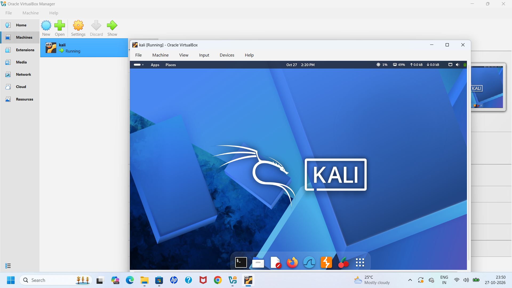
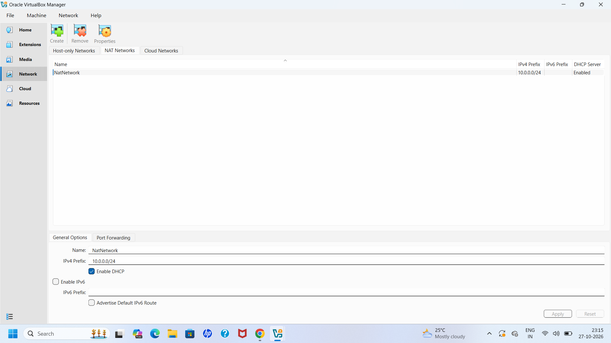
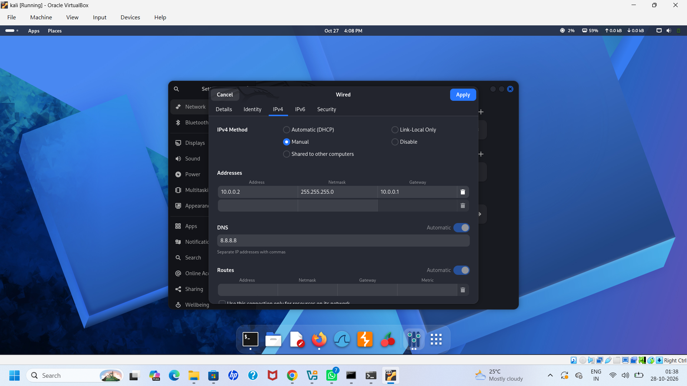
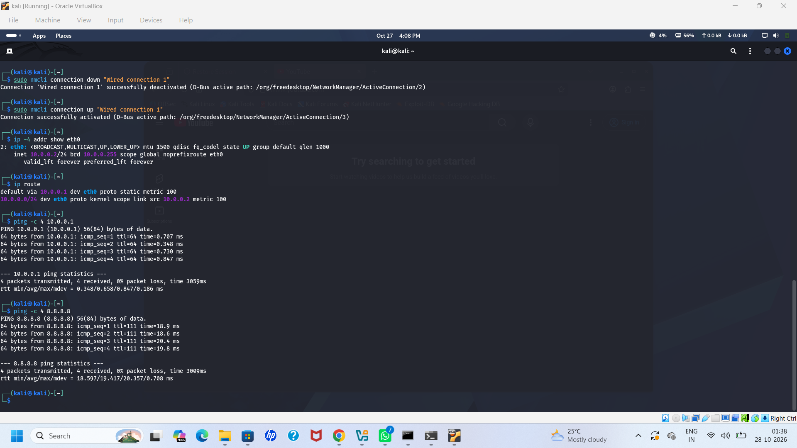
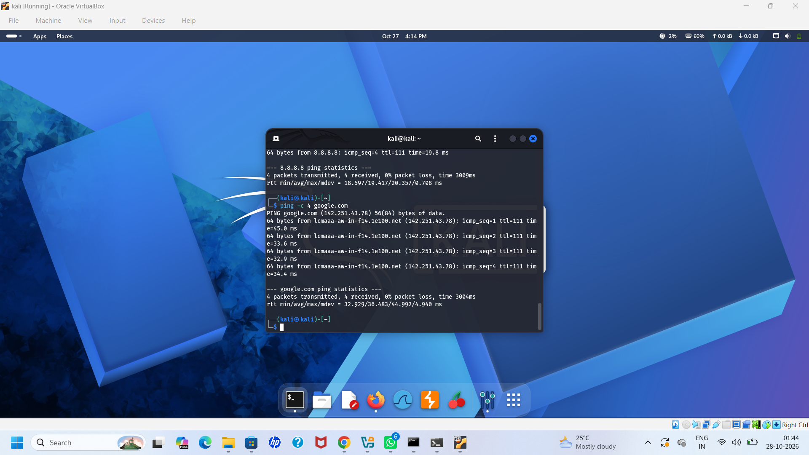
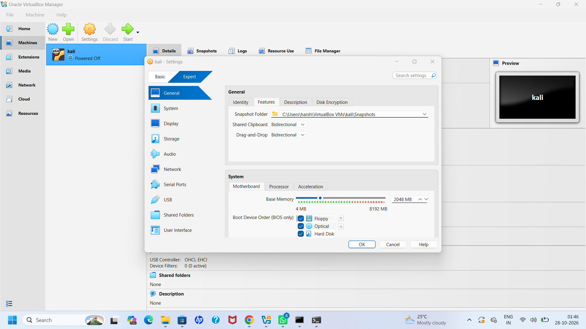
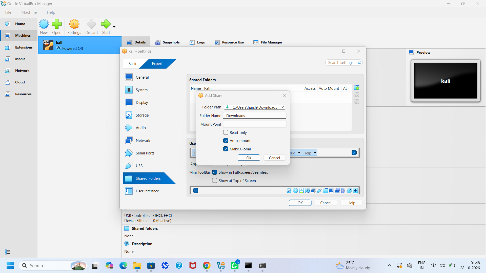
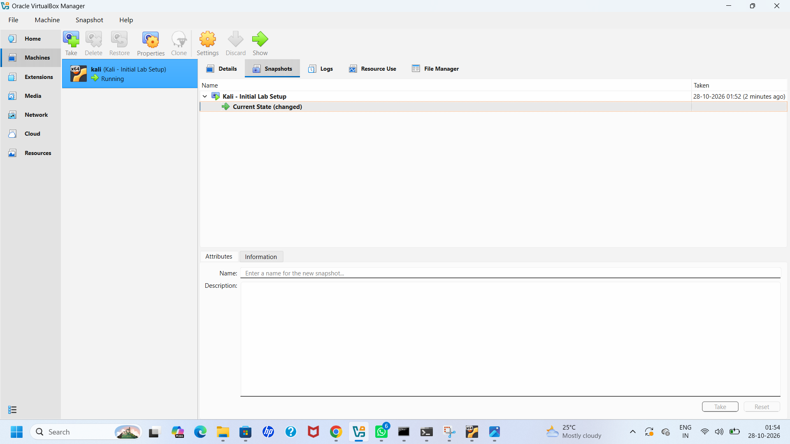

# Kali Linux Cybersecurity Lab

I set up Kali Linux in Oracle VirtualBox on my Windows laptop to create a virtual environment for practicing cybersecurity.

This repository documents how I installed and configured the virtual machine, set up networking, tested connectivity, and configured a few VirtualBox features.

## Tools Used

- Oracle VirtualBox
- Kali Linux
- Windows (Host OS)

## 1. Kali Linux Setup

I installed Kali Linux in VirtualBox and checked that the virtual machine was running properly.



## 2. Network Configuration

I created a NAT Network in VirtualBox to provide network connectivity for Kali Linux.

**NAT Network settings:**
- Network Name: `NatNetwork`
- Network CIDR: `10.0.0.0/24`



I then configured a static IP address in Kali Linux.

**Static IP settings:**
- IP Address: `10.0.0.2`
- Subnet Mask: `255.255.255.0`
- Gateway: `10.0.0.1`
- DNS Server: `8.8.8.8`



## 3. Network Connectivity Testing

After configuring the network, I used Linux commands to check the IP address, routing information, and connectivity.

**Commands used:**

```bash
ip a
ip route
ping 10.0.0.1
ping 8.8.8.8
ping google.com
```

I checked whether Kali Linux could communicate with the gateway, reach an external IP address, and resolve a domain name.





## 4. Clipboard and Drag-and-Drop Settings

I enabled the following options in VirtualBox:

- Shared Clipboard: Bidirectional
- Drag-and-Drop: Bidirectional

These settings make it easier to work between Windows and Kali Linux.



## 5. Shared Folder Setup

I configured my Windows Downloads folder as a shared folder in VirtualBox.

This was done to make file sharing between the host and virtual machine easier.



## 6. Virtual Machine Snapshot

After completing the initial setup, I created a VirtualBox snapshot named `Kali - Initial Lab Setup`.

This gives me a restore point in case I need to return to the initial configuration later.



## 7. Issues I Faced

While setting up the static IP address, I initially faced network connectivity issues.

The configured IP address appeared to be in use, and Kali Linux was unable to reach the gateway.

I checked the network configuration, reconnected the interface, and verified the IP address and default route.

After resolving the issue, I was able to successfully ping:

- The gateway (`10.0.0.1`)
- Google's public DNS server (`8.8.8.8`)
- `google.com`

## What I Learned

Through this setup, I got hands-on practice with:

- Creating and configuring a virtual machine in VirtualBox
- Understanding NAT networking
- Assigning a static IP address in Linux
- Checking IP addresses and routing information
- Troubleshooting basic network connectivity issues
- Configuring VirtualBox shared folders and convenience features
- Creating snapshots to save a working VM state

## Next Steps

I plan to use this Kali Linux environment to practice Linux commands, networking, and cybersecurity tools.

I'll continue documenting what I learn as I work on more hands-on exercises.